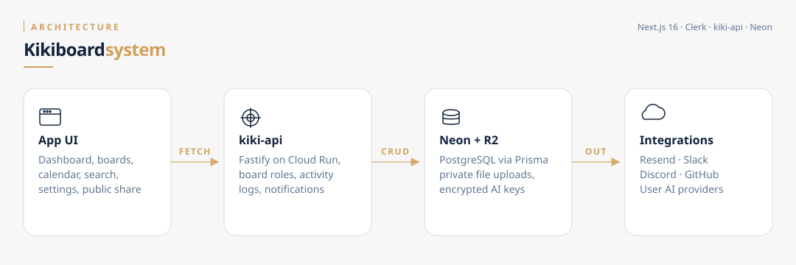

# Kikiboard application flows

Kikiboard is a collaborative project board (Kanban + list) built with Next.js 16 and Clerk (this repo, the frontend) on top of `kiki-api` (Fastify, Prisma, Neon, Cloudflare R2), which serves every route. These notes describe **how work moves through the product**, not every file.

Each page has an SVG diagram plus the route, permission, and side-effect details taken from the current code. **The behavior these guides describe is implemented in the `kiki-api` repository** (`src/routes`, `src/lib`, `prisma/schema.prisma`); the code pointers below say which repository each one is in. This repository holds the UI and the wiring (`lib/apiRoutes.ts`, `lib/api`).

## Context map

Use this page as a router. Read only the documents relevant to the change instead of loading the entire documentation set.

| Read when changing | Document | Primary code areas |
|---|---|---|
| Service boundaries, request flow, route protection, data relationships | [Architecture](./architecture.md) | `middleware.ts`, `app/`, `lib/api*`; kiki-api: `src/app.ts`, `prisma/schema.prisma` |
| Sign-in, identity linking, Clerk webhooks | [Auth and identity](./auth.md) | `app/(auth)`, `middleware.ts`; kiki-api: `src/routes/clerkWebhook.ts`, `src/lib/getOrCreateUser.ts` |
| Boards, lists, ownership, roles, permissions | [Boards and roles](./boards-and-roles.md) | kiki-api: `src/routes/boards.ts`, `lists.ts`, `access.ts`, `src/lib/boardAccess.ts`, `boardRoles.ts` |
| Invite delivery, tokens, acceptance, membership | [Invitations](./invitations.md) | `app/invite`; kiki-api: `src/routes/invitations.ts`, `members.ts`, `src/lib/invitationEmail.ts` |
| Task CRUD, moves, completion, files, fields, archive, epics | [Tasks](./tasks.md) | board task components, `lib/statusTheme.ts`; kiki-api: `src/routes/tasks.ts`, `createTasks.ts`, `subtasks.ts`, `attachments.ts`, `customValues.ts`, `archive.ts`, `epics.ts` |
| Assignment, QA, comments, activity, notifications | [Collaboration](./collaboration.md) | kiki-api: `src/routes/taskPeople.ts`, `comments.ts`, `notifications.ts`, `src/lib/createActivity.ts` |
| Provider credentials, transcription, parse/improve, brain dump, MCP | [AI](./ai.md) | kiki-api: `src/routes/ai.ts`, `mcp.ts`, `mcpSettings.ts`, `src/lib/mcp/`, `src/lib/secretCipher.ts`; here: `lib/mcpApiRewrites.ts` |
| Slack, Discord, Google Calendar, GitHub, sharing, email, MCP | [Integrations](./integrations.md) | kiki-api: `src/routes/integrations.ts`, `github.ts`, `share.ts`, `src/lib/github/`, `boardWebhooks.ts`; here: `app/api/integrations/github` |
| Security controls or certification planning | [ISO 27001 Compliance](./iso-27001-compliance-plan.md) | Cross-cutting; verify claims against current code and CI |
| Legal pages, privacy, cookies, consents, and compliance audit | [Legal compliance](./legal-compliance.md) | `app/(routes)/(home)/{terms,privacy,cookies}`, `components/CookieBanner.tsx`, `lib/cookieConsent.ts`, `SignUpConsentGate.tsx` |
| Spend, location, live traffic, then production security | [Production security checklist](./production-security-checklist.md) | Cross-cutting; section 1 is the service map plus the real-time view, and every row stays unreviewed until it has evidence |
| Client DB, offline/local-first sync, EventBus push vs poll | [Local-First architecture](./local-first-architecture.md) | Board Zustand store, `use-board-polling`, `kiki-api` events |

The code and kiki-api's Prisma schema are authoritative. When behavior changes, update the matching flow document in the same change.

## System at a glance

## Surfaces

| Route | Auth | Purpose |
|---|---|---|
| `/` `/functions` `/stats` `/privacy` `/terms` `/cookies` | Public | Marketing & legal pages |
| `/sign-in` `/sign-up` | Public | Clerk |
| `/dashboard` | Signed in | Personal stats, upcoming work, recent boards |
| `/dashboard/boards` | Signed in | Board list |
| `/dashboard/calendar` | Signed in | Month view of due dates |
| `/dashboard/tasks` | Signed in | My tasks |
| `/dashboard/settings` | Signed in | AI key, custom fields, calendar connect |
| `/board/[boardId]` | Board member | Kanban / list, activity, invites |
| `/invite/[token]` | Clerk-protected | Join a board (sign-in required before the page) |
| `/share/task/[token]` | Public | Read-only task |

## Side-effect cheat sheet

| Event | Activity log | In-app notification | Slack / Discord |
|---|---|---|---|
| Task created | `task_created` | — | Dispatcher supports it; not called from create yet |
| Task moved across lists | `task_moved` | — | Dispatcher supports it; not called from move yet |
| Task completed | `task_completed` | — | Yes, if `notifyOnTaskCompleted` |
| Assigned / QA / collaborator | yes | yes (not self) | — |
| Comment | — | assignee, QA, collaborators | — |
| Brain dump batch | `activity.brainDump` | — | — |
