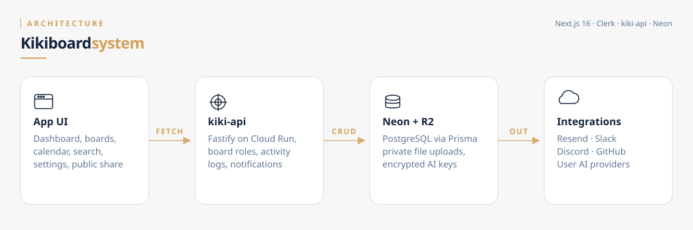
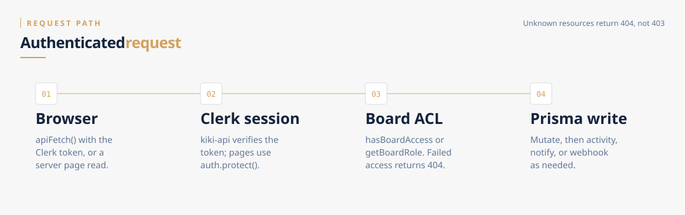
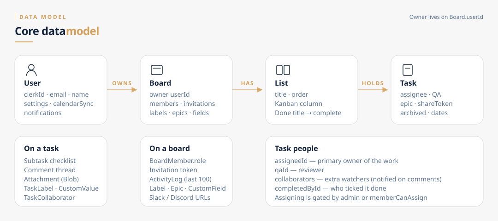
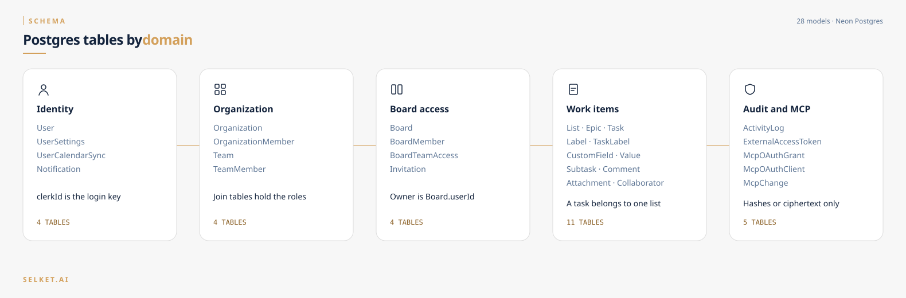
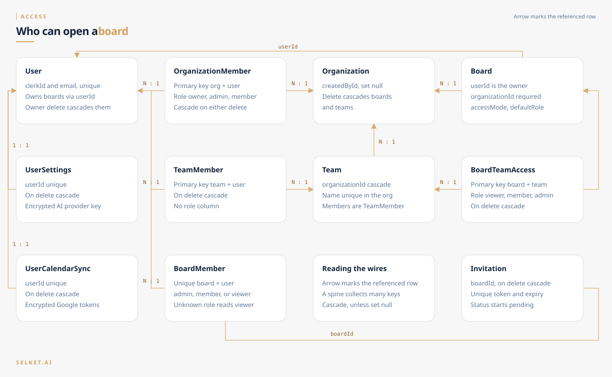
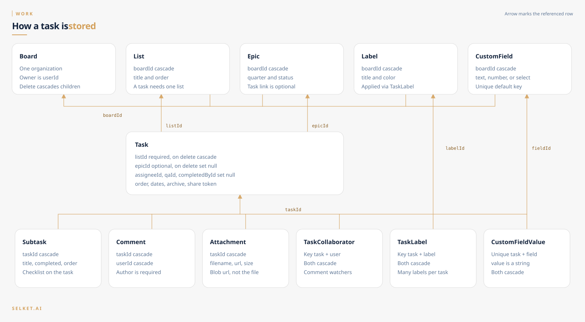
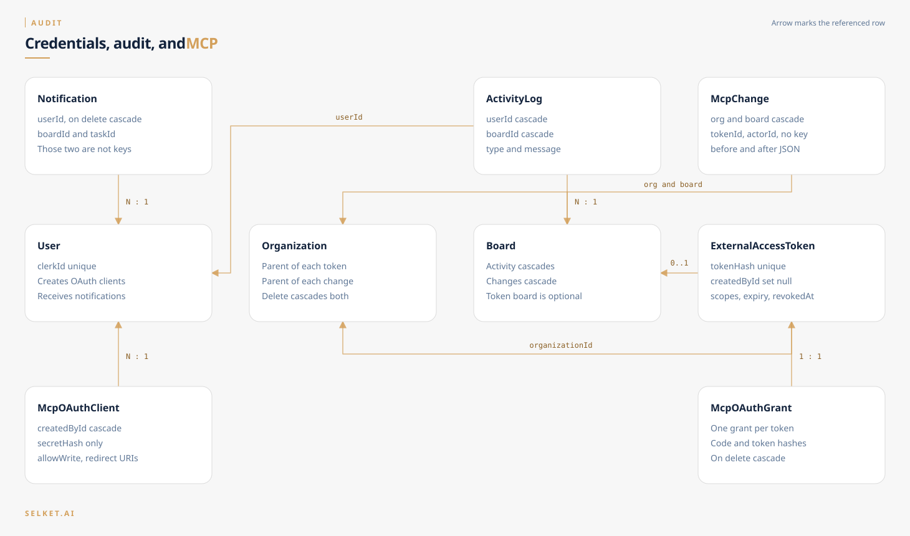

# Architecture

Kikiboard is a Next.js 16 App Router app. The browser talks to Route Handlers under `app/api`. Those handlers resolve the Clerk user to a Neon `User`, check board access, then mutate Prisma models. Outbound calls (email, chat webhooks, calendar, LLM providers) happen after the write.

## Stack

| Layer | Choice |
|---|---|
| UI | Next.js 16 App Router, Tailwind v4, shadcn/ui, Zustand, dnd-kit, Tiptap |
| Auth | Clerk (`clerkMiddleware` + `auth.protect`) |
| Data | Prisma 7 → PostgreSQL on Neon |
| Files | Cloudflare R2 (private bucket via `lib/blobStore.ts`) |
| Email | Resend |
| Deploy | Vercel |
| Runtime | Node.js 24.22.1 (see below) |

## Node.js runtime

Production and CI must run a binary that includes the 21 Oct 2026 Node.js security release (CVE-2026-111497 Brotli decoder RCE, plus TLS hostname-check bypasses). Patched floors are 22.23.4, 24.22.1, and 26.12.1. Node.js 18 and 20 receive no fix.

How this repo pins it:

- `.node-version` is `24.22.1`. GitHub Actions reads that file in `ci.yml`, `docker.yml`, and `image.yml`.
- `package.json` `engines.node` is `24.x` so Vercel matches the project setting (`24.x`) and cannot stay on Node 20. Vercel rolls 24.x patches itself; do not pin a patch version there.
- `scripts/check-node-patch.mjs` fails the workflow if the installed binary is below those floors.
- Rebase feature branches onto `main` before merge so they do not replace `node-version-file` with a floating `node-version`.

A Vercel project still on Node 20 is exposed even with these files. Set the project to 22.x or 24.x and redeploy.

## Request path

Almost every mutating API follows the same sequence.

1. **Clerk session.** `middleware.ts` protects everything except the public matcher (`/`, `/sign-in`, `/sign-up`, `/functions`, `/stats`, `/privacy`, `/terms`, `/cookies`, `/share/task`, the MCP paths, GitHub App setup callback).
2. **App user.** Handlers call `auth()`, then `db.user.findUnique({ clerkId })` or `getOrCreateUser`.
3. **Board ACL.** `hasBoardAccess` (owner **or** `BoardMember`) or `getBoardRole` for finer checks. Failed access is usually **404**, not 403, so callers cannot probe board ids.
4. **Write + side effects.** Prisma mutation, then `createActivity`, `notification.create`, and (on complete) Slack/Discord.

## Data model

Ownership is **not** a `BoardMember` row. `Board.userId` is the owner. Members live in `BoardMember` with `role` `"admin"`, `"member"`, or `"viewer"`. Unknown stored roles normalize to `"viewer"`.

A task belongs to exactly one `List` on one `Board`. People on a task:

- `assigneeId` — owner of the work
- `qaId` — reviewer
- `completedById` — who marked it done
- `TaskCollaborator` — extra watchers (comment notifications)

### Tables

`prisma/schema.prisma` is the source of truth. The map names every model. The three diagrams under it draw the foreign keys: the arrowhead sits on the referenced row.

Deletes cascade. Six links use `SetNull`: `Organization.createdById`, `ExternalAccessToken.createdById`, and on a task `epicId`, `assigneeId`, `qaId`, and `completedById`.

`Notification.boardId` and `Notification.taskId` are stored strings with no foreign key. So are `McpChange.tokenId`, `McpChange.actorId`, and `McpChange.revertsChangeId`. `revertsChangeId` is unique. MCP secrets and calendar tokens are stored as hashes or ciphertext, not plaintext.

## App surfaces after sign-in

- **Dashboard** — greeting, weekly activity, assigned work, upcoming due dates, recent boards.
- **Board** — Kanban or list; opt-in IndexedDB cache + mutation outbox (`NEXT_PUBLIC_LOCAL_FIRST=1`, `use-board-local-first`); SSE from kiki-api when `NEXT_PUBLIC_API_URL` is set; 25s polling safety net (`use-board-polling`); activity drawer. See [Local-First architecture](./local-first-architecture.md).
- **Calendar** — tasks with due dates, read from `GET /v1/calendar` (kiki-api) through `apiFetch`.
- **My tasks** — `/dashboard/tasks`.
- **Settings** — per-user AI credentials and custom fields.
- **Cmd+K search** — `/api/search` over boards and tasks the user can see.

## Container image

Besides Vercel, the app builds as a container for Cloud Run (`Dockerfile`, infrastructure in the `kiki-infra` repo).

- **Standalone output.** The image build sets `BUILD_STANDALONE=1`, which turns on `output: "standalone"` in `next.config.ts`. Vercel builds do not set it and are unchanged.
- **No secrets at build.** `next build` must succeed with none of the runtime secrets. Anything that needs a key at import time breaks that (the Resend client used to; it is now created on first use in `lib/resend.ts`). Only the two `NEXT_PUBLIC_*` values are build arguments, because Next inlines them into the browser bundle: `NEXT_PUBLIC_APP_URL` and `NEXT_PUBLIC_CLERK_PUBLISHABLE_KEY`. Neither is secret.
- **Migrations are not in the image, nor in this repository's pipeline.** `kiki-api` owns the schema and applies it in its own release step; this app never migrates.
- **Health check.** `GET /api/health` returns `{"status":"ok"}` without a session and without touching the database. It is excluded from the Clerk middleware matcher in `middleware.ts` so a Clerk outage or a development-instance handshake redirect cannot make the platform restart a healthy container.
- **CI.** `.github/workflows/image.yml` builds the image on pull requests that touch it and starts it with no secrets, calling the health check.
- **Registry.** On a push to `dev` the same workflow pushes the image to Artifact Registry as `<sha>` and `dev`, authenticating with GitHub OIDC as the `kikiboard-image-push` identity from `kiki-infra` (no stored keys; only `dev` can use it). It needs the repository variables `GCP_PROJECT_ID`, `GCP_WORKLOAD_IDENTITY_PROVIDER`, `GCP_IMAGE_PUSH_SERVICE_ACCOUNT`, `STAGING_APP_URL` and `STAGING_CLERK_PUBLISHABLE_KEY`, and is skipped until they exist.
- **Deploy.** After the push, a second job rolls the image out to the staging Cloud Run service (`kikiboard`, europe-west1) with `gcloud run services update --image`, by commit SHA, then calls `/api/health` on the service URL. Only the image changes: secrets, the runtime identity and scaling stay as Terraform set them.
- **Migrations.** None here. The `migrate` job of `kiki-api`'s `image.yml` applies them before its deploy (see its `docs/deploy.md`). This pipeline only builds, pushes and rolls out the image.

## Everything is served by kiki-api

This app has no backend of its own. `kiki-api` (a separate Fastify service on Google Cloud) serves every route, applies the database migrations and holds the credentials; this repository is the UI, the client state and a few redirects. What is left under `app/api` is `health` (the container's liveness probe) and the two GitHub redirects (`integrations/github/setup` and `result`), which need the Clerk cookie that only lives here and only relay to the API.

The browser calls the API through one helper, `apiFetch` in `lib/apiClient.ts`:

**New API work:** implement the handler in `kiki-api` first (`/v1/...`), open a PR there, merge and deploy, then wire this app. Do not add handlers to `app/api`. Schema changes and their migrations are made in `kiki-api` only. Never push straight to `main`.

- Components still name their calls by the older `/api/...` paths; `lib/apiRoutes.ts` maps each, by method and path, to its `/v1/...` route. A call with no route throws, so a missing line fails in development and not silently in production.
- The call goes to `NEXT_PUBLIC_API_URL` with the Clerk session token as `Authorization: Bearer`. The variable is a build-time value (inlined into the browser bundle) and not a secret. If it is unset, `apiFetch` throws.
- Clerk's SDK loads a moment after the page, so the first call waits (up to 3 seconds, once per page) for it to finish loading before it asks for a token. With no session (a signed-out visitor behind an invitation link, or Clerk never loaded) the call goes without a token and the API answers 401 for whatever needs one.
- There is no retry and no fallback: a failed read or write is answered as the API answered it, and a write is never repeated.
- The API accepts the token only from the frontend origins listed in its `CORS_ORIGINS`.
- The MCP endpoint and its OAuth server are kiki-api's too, forwarded under this app's public address by `next.config.ts` (`lib/mcpApiRewrites.ts`).

### Server-rendered pages read from the API too (KI-00057)

The pages that render on the server no longer query the database. They call kiki-api with `apiServerGet` in `lib/apiServer.ts`, which sends the signed-in person's Clerk session token (`auth().getToken()`) to `NEXT_PUBLIC_API_URL` and turns the `…At` / `…Date` strings back into `Date` objects. The routes are described in kiki-api's `docs/page-reads.md`.

- A 4xx is an answer the page decides on (`redirect` to sign-in, or to the access-denied screen). The API failing or being unreachable throws, so the page's error boundary shows it instead of an empty screen.
- `NEXT_PUBLIC_API_URL` must be set wherever these pages run (production, staging, and any preview or local run that opens them): there is no other backend to fall back to.
- Every server page reads from the API: dashboard layout and home, boards list, my tickets, board, board observability, organizations (the GitHub setup result, `GET /v1/integrations/github/result` with the token in the `x-github-result-token` header, which does not consume it), MCP authorization, and the public ticket link (`GET /v1/shared/tasks/:token`, sent without a session). None of them imports the database.
- A page that hands the data to components typed on the Prisma models asks with `{ dates: "keep" }` and maps it with the `…FromApi` helpers in `lib/api` (`boardFromApi`, `boardTaskFromApi`, `listsFromApi`), which also null the secrets the API never sends. Pages that only read values take the default, where the `…At` / `…Date` strings arrive as `Date`.

The API answers errors as `{ error: code, message }`. A screen that shows the error to the user reads `message` first and falls back to `error` (`CreateBoardStepper`, `OrganizationsClient`).

The API does not send the Slack and Discord webhook URLs in a board, so `boardFromApi` (`lib/api/boards.ts`) sets them to null.

### The API contract

`kiki-api` declares a zod schema for what each route accepts and returns, and publishes an OpenAPI document built from those schemas (`GET /openapi.json`). This app generates its types from it:

- `lib/api/schema.d.ts` is generated (do not edit). `pnpm api:types` rewrites it from the staging API; `pnpm api:types ./openapi.json` reads a local file (`pnpm openapi > openapi.json` in `kiki-api`).
- `lib/api/types.ts` exports `ApiLabel`, `ApiError` and `ApiGetResponse<Path>`, the JSON body of a GET route. Read a migrated route's response through them (see `TaskLabels`), and map it to the screen's model by field name in `lib/api/`, as `labelFromApi` does. If the API changes a field, `tsc` fails in the pull request, not in production.
- CI runs `node scripts/api-types.mjs --check`. It fails only when something `lib/api/schema.d.ts` already knows was **removed or changed in a way that is not purely additive** (a route that disappears, a field that is removed, retyped or becomes optional), and lists what broke. A new route, a new schema or a new field does not fail it, so deploying the API never turns the open pull requests of other people red; it prints a note and `pnpm api:types` picks the new things up when you need them. If the API cannot be reached the check is skipped. The comparison is `scripts/apiTypesDiff.mjs`, by route and by schema, regardless of order. Limit: a new *required* field in a request body is additive here, and the callers do not type their request bodies yet.
- **Order:** merge and deploy the `kiki-api` change first, then regenerate here. Every API error is `{ error, message }` (`ApiError`).

