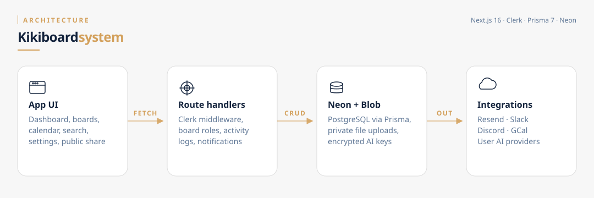
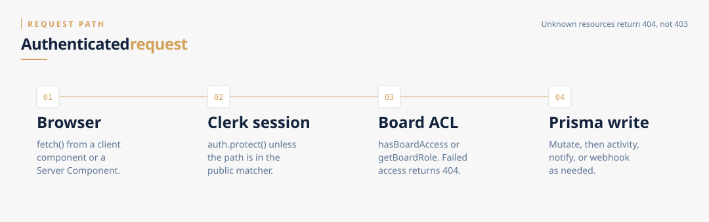
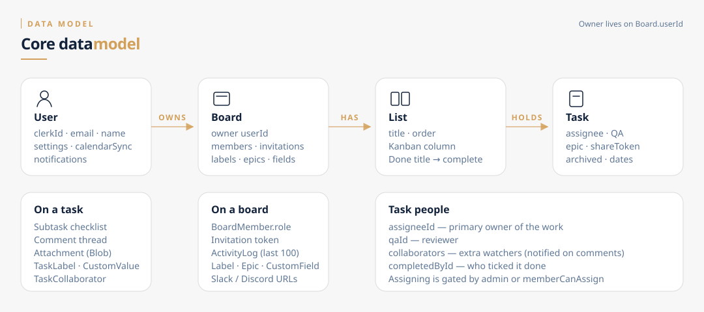
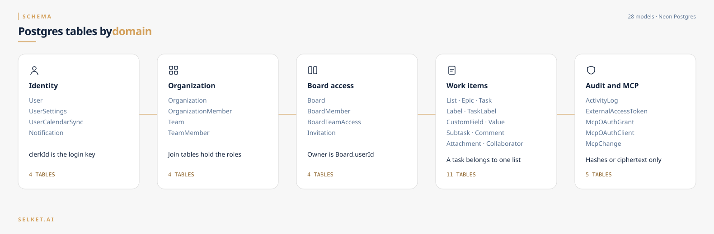
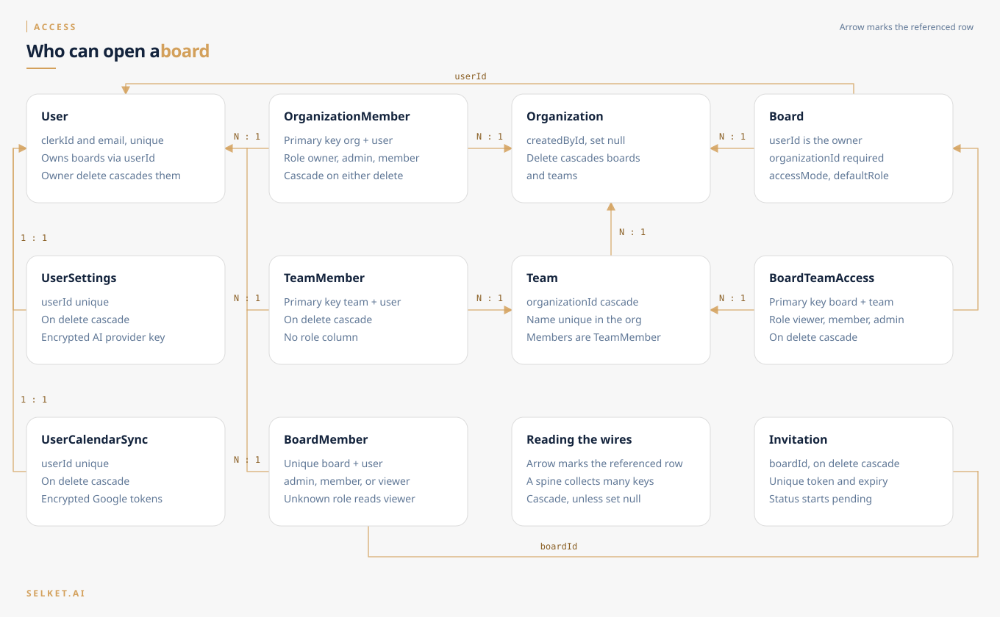
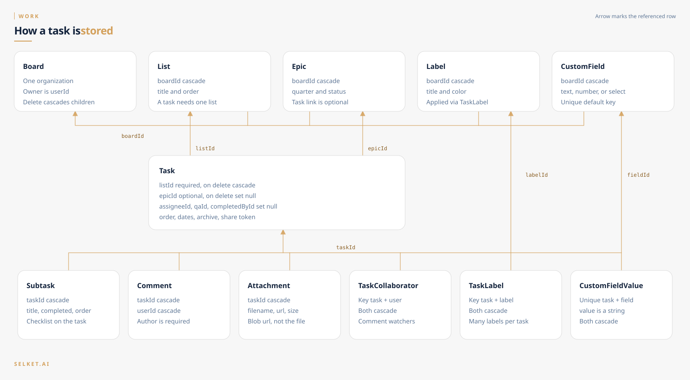
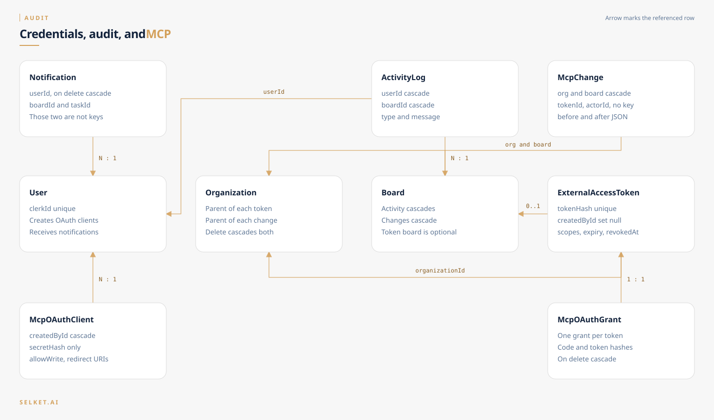

# Architecture

Kikiboard is a Next.js 16 App Router app. The browser talks to Route Handlers under `app/api`. Those handlers resolve the Clerk user to a Neon `User`, check board access, then mutate Prisma models. Outbound calls (email, chat webhooks, calendar, LLM providers) happen after the write.

## Stack

| Layer | Choice |
|---|---|
| UI | Next.js 16 App Router, Tailwind v4, shadcn/ui, Zustand, dnd-kit, Tiptap |
| Auth | Clerk (`clerkMiddleware` + `auth.protect`) |
| Data | Prisma 7 → PostgreSQL on Neon |
| Files | Vercel Blob (`access: "private"`) |
| Email | Resend |
| Deploy | Vercel |
| Runtime | Node.js 24.22.1 (see below) |

## Node.js runtime

Production and CI must run a binary that includes the 21 Oct 2026 Node.js security release (CVE-2026-111497 Brotli decoder RCE, plus TLS hostname-check bypasses). Patched floors are 22.23.4, 24.22.1, and 26.12.1. Node.js 18 and 20 receive no fix.

How this repo pins it:

- `.node-version` is `24.22.1`. GitHub Actions reads that file in `ci.yml`, `docker.yml`, and `image.yml`.
- `package.json` `engines.node` is `24.x` so Vercel matches the project setting (`24.x`) and cannot stay on Node 20. Vercel rolls 24.x patches itself; do not pin a patch version there.
- `scripts/check-node-patch.mjs` fails the workflow if the installed binary is below those floors.
- Rebase feature branches onto `main` before merge so they do not replace `node-version-file` with a floating `node-version`.

A Vercel project still on Node 20 is exposed even with these files. Set the project to 22.x or 24.x and redeploy.

## Request path

Almost every mutating API follows the same sequence.

1. **Clerk session.** `middleware.ts` protects everything except the public matcher (`/`, `/sign-in`, `/sign-up`, `/functions`, `/stats`, `/privacy`, `/share/task`, `/api/webhooks`, Google Calendar callback, GitHub App setup callback).
2. **App user.** Handlers call `auth()`, then `db.user.findUnique({ clerkId })` or `getOrCreateUser`.
3. **Board ACL.** `hasBoardAccess` (owner **or** `BoardMember`) or `getBoardRole` for finer checks. Failed access is usually **404**, not 403, so callers cannot probe board ids.
4. **Write + side effects.** Prisma mutation, then `createActivity`, `notification.create`, and (on complete) Slack/Discord.

## Data model

Ownership is **not** a `BoardMember` row. `Board.userId` is the owner. Members live in `BoardMember` with `role` `"admin"`, `"member"`, or `"viewer"`. Unknown stored roles normalize to `"viewer"`.

A task belongs to exactly one `List` on one `Board`. People on a task:

- `assigneeId` — owner of the work
- `qaId` — reviewer
- `completedById` — who marked it done
- `TaskCollaborator` — extra watchers (comment notifications)

### Tables

`prisma/schema.prisma` is the source of truth. The map names every model. The three diagrams under it draw the foreign keys: the arrowhead sits on the referenced row.

Deletes cascade. Six links use `SetNull`: `Organization.createdById`, `ExternalAccessToken.createdById`, and on a task `epicId`, `assigneeId`, `qaId`, and `completedById`.

`Notification.boardId` and `Notification.taskId` are stored strings with no foreign key. So are `McpChange.tokenId`, `McpChange.actorId`, and `McpChange.revertsChangeId`. `revertsChangeId` is unique. MCP secrets and calendar tokens are stored as hashes or ciphertext, not plaintext.

## App surfaces after sign-in

- **Dashboard** — greeting, weekly activity, assigned work, upcoming due dates, recent boards.
- **Board** — Kanban or list, live-ish polling (`use-board-polling`), activity drawer.
- **Calendar** — `/api/calendar` tasks with due dates.
- **My tasks** — `/dashboard/tasks`.
- **Settings** — per-user AI credentials, custom fields, Google Calendar OAuth.
- **Cmd+K search** — `/api/search` over boards and tasks the user can see.

## Container image

Besides Vercel, the app builds as a container for Cloud Run (`Dockerfile`, infrastructure in the `kiki-infra` repo).

- **Standalone output.** The image build sets `BUILD_STANDALONE=1`, which turns on `output: "standalone"` in `next.config.ts`. Vercel builds do not set it and are unchanged.
- **No secrets at build.** `next build` must succeed with none of the runtime secrets. Anything that needs a key at import time breaks that (the Resend client used to; it is now created on first use in `lib/resend.ts`). Only the two `NEXT_PUBLIC_*` values are build arguments, because Next inlines them into the browser bundle: `NEXT_PUBLIC_APP_URL` and `NEXT_PUBLIC_CLERK_PUBLISHABLE_KEY`. Neither is secret.
- **Migrations are not in the image.** They run as a release step against `DATABASE_URL_UNPOOLED`, never inside the container start or the build.
- **Health check.** `GET /api/health` returns `{"status":"ok"}` without a session and without touching the database. It is excluded from the Clerk middleware matcher in `middleware.ts` so a Clerk outage or a development-instance handshake redirect cannot make the platform restart a healthy container.
- **CI.** `.github/workflows/image.yml` builds the image on pull requests that touch it and starts it with no secrets, calling the health check.
- **Registry.** On a push to `dev` the same workflow pushes the image to Artifact Registry as `<sha>` and `dev`, authenticating with GitHub OIDC as the `kikiboard-image-push` identity from `kiki-infra` (no stored keys; only `dev` can use it). It needs the repository variables `GCP_PROJECT_ID`, `GCP_WORKLOAD_IDENTITY_PROVIDER`, `GCP_IMAGE_PUSH_SERVICE_ACCOUNT`, `STAGING_APP_URL` and `STAGING_CLERK_PUBLISHABLE_KEY`, and is skipped until they exist.
- **Deploy.** After the push, a second job rolls the image out to the staging Cloud Run service (`kikiboard`, europe-west1) with `gcloud run services update --image`, by commit SHA, then calls `/api/health` on the service URL. Only the image changes: secrets, the runtime identity and scaling stay as Terraform set them.
- **Migrations.** Before the deploy, a `migrate` job runs `scripts/ci-migrate.sh`, which applies pending Prisma migrations against the direct Neon URL (`DATABASE_URL_UNPOOLED`, read from Secret Manager, masked in the logs). If it fails, nothing is deployed. It reads the migration status first and fails if it cannot (it never assumes there is nothing to do), and it blocks a pending migration with a destructive statement (`DROP TABLE/COLUMN/SCHEMA`, `TRUNCATE`, `DELETE FROM`, a column type change) because old instances keep running against the new schema while a deploy rolls out: split it into two releases, or add `[allow-destructive-migration]` to the commit message. `prisma migrate deploy` is idempotent, so it coexists with the migration Vercel still runs in its own build. Migrations never run inside `next build` or when the container starts.

## Routes served by kiki-api

The backend is moving route by route to `kiki-api` (a separate Fastify service on Google Cloud). While it moves, the browser calls the API through one helper, `apiFetch` in `lib/apiClient.ts`:

- `lib/apiRoutes.ts` lists the routes already served by `kiki-api`, by method and path. Everything else still goes to this app's own `/api` routes. Moving a route is one line there, plus the route in `kiki-api`.
- A migrated route is sent to `NEXT_PUBLIC_API_URL` with the Clerk session token as `Authorization: Bearer`, and `/api/...` becomes `/v1/...`.
- **`NEXT_PUBLIC_API_URL` unset means nothing changes**: every call is the plain same-origin fetch. Local development and Vercel previews do not need it. It is a build-time value (inlined into the browser bundle) and not a secret.
- Clerk's SDK loads a moment after the page, so the first migrated call waits (up to 3 seconds, once per page) for it to finish loading before it asks for a token. Without that wait, the first call of a page (the notification bell asks as soon as it mounts) found no session and went to this app's own route.
- If there is still no session token (a signed-out visitor, or Clerk never loaded), the call falls back to the same-origin route, which still exists here.
- A **read** that the API cannot serve (unreachable, blocked by CORS, a 401, a 5xx) is answered by the route this app still has. A 404 is a real answer and is kept. A write is never repeated. Remove the fallback when the route is deleted from this app.
- The API accepts the token only from the frontend origins listed in its `CORS_ORIGINS`.

Migrated so far (the old handler is still in `app/api` until the comparison on staging is done, then it is deleted):

| Group | Old path (app) | kiki-api |
|---|---|---|
| Labels | `GET`/`POST /api/labels/[boardId]` | `GET`/`POST /v1/labels/:boardId` |
| | `PATCH`/`DELETE /api/labels/label/[labelId]` | `PATCH`/`DELETE /v1/labels/:labelId` |
| Lists | `POST /api/lists/createList` | `POST /v1/lists` |
| | `PATCH /api/lists/updateOrder` | `PATCH /v1/lists/order` |
| | `PATCH /api/lists/updateList/[listId]` | `PATCH /v1/lists/:listId` |
| | `DELETE /api/lists/deleteList/[listId]` | `DELETE /v1/lists/:listId` |
| Notifications | `GET`/`PATCH /api/notifications`, `PATCH /api/notifications/[id]` | same names under `/v1` |
| Search | `GET /api/search` | `GET /v1/search` |
| Boards | `GET /api/boards/getBoards`, `POST /api/boards/createBoard` | `GET`, `POST /v1/boards` |
| | `PATCH /api/boards/updateBoard/[boardId]`, `DELETE /api/boards/deleteBoard/[boardId]` | `PATCH`, `DELETE /v1/boards/:boardId` |
| | `GET /api/boards/[boardId]/activity` | `GET /v1/boards/:boardId/activity` |
| | `GET`, `PUT /api/boards/[boardId]/links` | same under `/v1` |
| | `PATCH /api/boards/[boardId]/permissions`, `PATCH /api/boards/[boardId]/organization` | same under `/v1` |
| | `GET`, `PATCH /api/boards/[boardId]/access`, `GET`, `POST`, `PATCH /api/boards/[boardId]/archive` | same under `/v1` |
| | `GET`, `POST`, `PATCH`, `DELETE /api/boards/[boardId]/epics`, `GET`, `PATCH /api/boards/[boardId]/integrations` | same under `/v1` |
| | `GET /api/boards/[boardId]/invitations` (people and pending invitations), `PATCH`, `DELETE /api/boards/[boardId]/members/[memberId]` | `GET /v1/boards/:boardId/members`, `PATCH`, `DELETE /v1/boards/:boardId/members/:memberId` |
| | `POST /api/boards/[boardId]/invitations`, `DELETE /api/boards/[boardId]/invitations/[invitationId]` | same under `/v1` |
| | `GET /api/invite/[token]` (public), `POST /api/invite/[token]` | `GET /v1/invitations/:token`, `POST /v1/invitations/:token/accept` |
| | `GET`, `POST`, `DELETE` `.../external-access` of a board and of an organization | same under `/v1` |
| Organizations | `GET`, `POST /api/organizations`, `GET`, `POST`, `PATCH`, `DELETE /api/organizations/[organizationId]/members`, `GET .../available-members` | same under `/v1` |
| | `GET`, `POST .../teams`, `POST`, `DELETE .../teams/[teamId]/members` and `.../teams/[teamId]/boards` | same under `/v1` |
| Tickets | `PATCH /api/tasks/updateTask/[taskId]`, `DELETE /api/tasks/deleteTask/[taskId]` | `PATCH`, `DELETE /v1/tasks/:taskId` |
| | `PATCH /api/tasks/updateOrder`, `GET /api/boards/[boardId]/tasks` | `PATCH /v1/tasks/order`, `GET /v1/boards/:boardId/tasks` |
| | `POST /api/tasks/[taskId]/labels`, `.../assignee`, `.../qa`, `.../collaborators` | same under `/v1` |
| | `GET`, `POST .../subtasks`, `PATCH`, `DELETE .../subtasks/[subtaskId]` | same under `/v1` |
| | `GET`, `PATCH .../custom-values`, `GET`, `POST`, `DELETE .../share` | same under `/v1` |
| | `GET .../comments`, `DELETE .../comments/[commentId]` | same under `/v1` |
| Onboarding | `PATCH /api/onboarding` | `PATCH /v1/onboarding` |

Still served by this app: creating a ticket, posting a comment (Kiki answers after the response), attachments and the Kiki agent routes (`agent-apply`, `agent-undo`).

The GitHub routes under an organization (`/api/organizations/[organizationId]/github/...`) are not migrated yet: they move together with the GitHub setup callbacks, since they share the same libraries and secrets.

A route marked `public` in `lib/apiRoutes.ts` (today only the page behind an invitation link) goes to the API even when nobody is signed in, without a token. That is what lets the old handler be deleted without breaking a signed-out visitor.

A write is never repeated: if the API fails, the action fails and the user sees the screen's own error.

The API answers errors as `{ error: code, message }`; the app's own routes sent `{ error: text }`. A screen that shows the error to the user reads `message` first and falls back to `error` (`CreateBoardStepper`, `OrganizationsClient`).

The API does not send the Slack and Discord webhook URLs in a board, so `boardFromApi` (`lib/api/boards.ts`) sets them to null. Types such as `ApiBoardLink` come from the contract, not from an old route file, so deleting the old handlers later does not break the build.

**Do not delete the old handlers in `app/api` yet.** Production (`main`) serves these routes from this app, and the Vercel variable `NEXT_PUBLIC_API_URL` exists only for the `dev` branch. The next promotion of `dev` to `main` would bring `apiFetch` to production without it, and production would call its own routes. Until the production API exists (ticket "production environment"), the old handlers stay, and so does the fallback. Previews of other branches and local development also rely on them when the variable is unset.

### The API contract

`kiki-api` declares a zod schema for what each route accepts and returns, and publishes an OpenAPI document built from those schemas (`GET /openapi.json`). This app generates its types from it:

- `lib/api/schema.d.ts` is generated (do not edit). `pnpm api:types` rewrites it from the staging API; `pnpm api:types ./openapi.json` reads a local file (`pnpm openapi > openapi.json` in `kiki-api`).
- `lib/api/types.ts` exports `ApiLabel`, `ApiError` and `ApiGetResponse<Path>`, the JSON body of a GET route. Read a migrated route's response through them (see `TaskLabels`), and map it to the screen's model by field name in `lib/api/`, as `labelFromApi` does. If the API changes a field, `tsc` fails in the pull request, not in production.
- CI runs `node scripts/api-types.mjs --check`. It fails only when something `lib/api/schema.d.ts` already knows was **removed or changed in a way that is not purely additive** (a route that disappears, a field that is removed, retyped or becomes optional), and lists what broke. A new route, a new schema or a new field does not fail it, so deploying the API never turns the open pull requests of other people red; it prints a note and `pnpm api:types` picks the new things up when you need them. If the API cannot be reached the check is skipped. The comparison is `scripts/apiTypesDiff.mjs`, by route and by schema, regardless of order. Limit: a new *required* field in a request body is additive here, and the callers do not type their request bodies yet.
- **Order:** merge and deploy the `kiki-api` change first, then regenerate here. Every API error is `{ error, message }` (`ApiError`).

