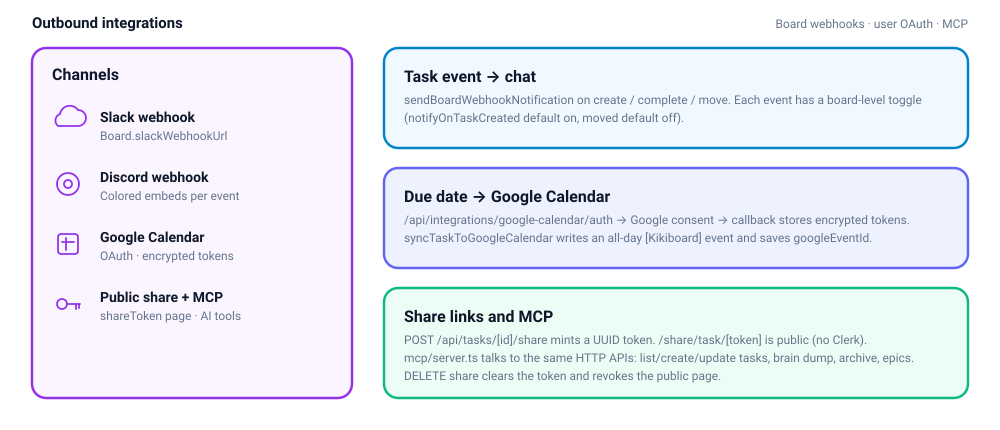

# Integrations

Boards can fan out to chat. Users can sync due dates to Google Calendar. An organization can link a GitHub account, repository, and branch. Anyone with a share token can read a task without signing in. Agents can drive the HTTP API through MCP.

## Slack and Discord

Stored on the board (`slackWebhookUrl`, `discordWebhookUrl`) plus three flags:

| Flag | Default | Event |
|---|---|---|
| `notifyOnTaskCreated` | true | `task_created` |
| `notifyOnTaskCompleted` | true | `task_completed` |
| `notifyOnTaskMoved` | false | `task_moved` |

`sendBoardWebhookNotification` in `lib/notifications/webhooks.ts` loads those fields, bails if the flag is off, then POSTs Slack `blocks` and/or a Discord embed.

**Wired today:** `PATCH /api/tasks/updateTask/[taskId]` fires `task_completed` when `completed` flips to true. The dispatcher also understands created and moved, and the board UI can store those flags, but create/move handlers do not call it yet.

Admins configure URLs at `/api/boards/[boardId]/integrations`.

## Google Calendar

Per-user `UserCalendarSync` (encrypted access + refresh tokens).

1. `GET /api/integrations/google-calendar/auth` (signed in) redirects to Google OAuth (`calendar.events`, `access_type=offline`, `prompt=consent`). `state` is the Kikiboard user id.
2. Callback `/api/integrations/google-calendar/callback` is **public** in the Clerk matcher (Google redirects here). It exchanges the code and upserts tokens.
3. `syncTaskToGoogleCalendar` can create an all-day `[Kikiboard] {title}` event on the primary calendar and store `Task.googleEventId`. Expired access tokens are refreshed first.
4. **Dormant:** nothing in task create/update calls the sync helper, and Settings has no calendar tab that starts the OAuth flow. The in-app `/dashboard/calendar` is Neon due dates (`GET /api/calendar`), not Google.

## GitHub

One GitHub App, owned by Kikiboard, serves every organization. Registering it, installing it, and calling the API are free on GitHub Free. Do not list the app on GitHub Marketplace. A Marketplace paid plan is what makes GitHub charge the installer.

The app id, slug, private key, webhook secret, OAuth state secret, OAuth client id, and OAuth client secret are deployment secrets (`GITHUB_APP_ID`, `GITHUB_APP_SLUG`, `GITHUB_APP_PRIVATE_KEY`, `GITHUB_APP_WEBHOOK_SECRET`, `GITHUB_APP_STATE_SECRET`, `GITHUB_APP_CLIENT_ID`, `GITHUB_APP_CLIENT_SECRET`). The webhook secret, state secret, and client secret must each be at least 16 characters, and the state secret must be different from the webhook secret. The private key may be a PEM with newlines written as `\n`, or a base64-encoded PEM. Installation access tokens last one hour and are minted when listing repositories or branches. They are not stored. User access tokens from the install check are not stored either.

Register the app under the Kikiboard GitHub account (Settings → Developer settings → GitHub Apps → New GitHub App):

- Homepage URL: `NEXT_PUBLIC_APP_URL`.
- Callback URL: `{APP_URL}/api/integrations/github/setup`. Leave **Request user authorization (OAuth) during installation** off. That option removes the Setup URL. Kikiboard starts the user-authorization flow itself after the install redirect.
- Setup URL: `{APP_URL}/api/integrations/github/setup`. Enable redirect on update.
- Webhook URL: `{APP_URL}/api/webhooks/github`. Secret: `GITHUB_APP_WEBHOOK_SECRET`.
- Repository permission: Contents, Read-only. Metadata is granted automatically.
- Subscribe to Installation and Installation repositories.
- Installation visibility: Any account. `GITHUB_APP_SLUG` is the slug in `https://github.com/apps/{slug}`.

`OrganizationGithubConnection` stores one installation per Kikiboard organization: GitHub account login and type (`Organization` or `User`), the selected `owner/name` repository, and the selected branch. Organization owners and admins connect and change it. Other members can see the saved account, repository, and branch. The GitHub settings link, which contains the installation id, is returned only to owners and admins.

1. `POST /api/organizations/{organizationId}/github/install` (owner or admin) stores a single-use attempt and returns the GitHub install URL with a signed `state` that expires after 10 minutes. The browser then navigates there. A cross-site GET cannot start this, because the route does not accept GET.
2. GitHub redirects to `/api/integrations/github/setup`, which is public in the Clerk matcher so the browser can land there. The handler requires the Clerk session to be the manager who started the attempt. It does not trust `installation_id`. It redirects that same user through GitHub's OAuth flow (PKCE, verifier stored on the attempt) and accepts the installation only when `GET /user/installations` for that user token includes it. An installation already linked to another Kikiboard organization, or one that was retired when a previous installation was replaced, is rejected. The previous installation id is retired in the database before GitHub is asked to uninstall it.
3. If GitHub sends `setup_action=request`, no installation is stored. The organizations page shows that an owner still has to approve the app. `POST /api/organizations/{organizationId}/github/finish` (owner or admin) returns a GitHub authorize URL. When the approving user's token can see exactly one claimable installation, it is saved. When it can see several, the user picks one; the choices are the installations that token returned, not ids from the query string. `installation.created` webhooks are ignored, because they do not identify the Kikiboard organization.
4. `setup_action=update` refreshes the account on an installation this signed-in manager already owns. It never creates a row for an installation id that is not already stored.
5. The organizations page lists repositories and branches for that installation, following GitHub's `Link` header until it ends, with a safety cap of 100 pages. `PATCH` then checks the chosen repository with `GET /repositories/{id}` and the branch with `GET /repos/{owner}/{repo}/branches/{branch}`, so a repository past the page cap can still be saved.
6. `DELETE` uninstalls the GitHub App installation, retires that installation id, and deletes the row. If the server secrets are missing, it leaves the row in place.
7. Successful and failed setup redirects set an httpOnly `github_setup_result` cookie bound to the signed-in user. The organizations page reads that cookie and the browser consumes it with `POST /api/integrations/github/result`, which clears the cookie. The token is not placed in the query string. The callback also checks again that the session user is still an owner or admin before it stores an installation.
8. `POST /api/webhooks/github` checks `X-Hub-Signature-256`. A missing configuration and a bad signature both return 401, and a body over 1 MB is rejected. `installation` `deleted` removes the row. `installation_repositories` `removed` clears the repository and branch when the saved repository was removed. Deletes and repository clears are safe to retry.

Each board has a two-letter key, unique in its organization, taken from the board title (`Lyvora sounds` becomes `LS`). The board owner can change that key until the first ticket on the board is numbered. After that, the key stays so existing ticket keys do not change. Each ticket receives the next number on its board, in creation order, and keeps it. The visible key is `{key}-{number}` with the number padded to five digits, for example `LY-00042`.

Opening a ticket always shows a checkout command for `{key}-{slug of the title}`. The explanation of that command sits in the info control beside it, not as extra copy on the ticket. The command does not depend on a GitHub connection. When the organization has a saved base branch, the command includes it:

`git checkout -b LY-00042-ca-cd-cost-optimisation`

`git checkout -b LY-00042-ca-cd-cost-optimisation origin/dev`

`GET /api/tasks/{taskId}/development` requires a signed-in reader of the board. When the organization has a saved repository, it asks GitHub for `GET /repos/{owner}/{repo}/git/matching-refs/heads/{key}` and lists the branches that are the key, or that start with the key followed by `-` or `/`. Those links open `https://github.com/{owner}/{repo}/tree/{branch}`. Nothing is stored. A missing GitHub App configuration looks the same as an organization with no repository: the ticket still shows the checkout command, and it shows no branch links. Creating the branch, pull requests, commits, and issue sync stay outside Kikiboard.

## Sharing a ticket

The share dialog offers two links.

The private link is `/board/{boardId}?taskId={taskId}`. It is the normal ticket URL, so nothing is created or stored. Only someone who can read the board can open it. A signed-in person who cannot read that board is sent to `/dashboard?access=denied`, and the dashboard says they do not have access. A missing board uses the same redirect, so the warning does not reveal whether the board exists.

The public link is separate and still has to be created:

`POST /api/tasks/[taskId]/share` — mint or reuse a UUID `shareToken`.

URL: `{APP_URL}/share/task/{token}` — listed as public in middleware. The page loads the task by token (labels, subtasks, epic, attachments, comments) and renders a read-only view.

`DELETE` sets `shareToken` to null and kills the link.

`GET` returns the current token/url for the share UI.

## Email

Invites are the Resend integration (`app/api/boards/[boardId]/invitations/route.ts`). See [Invitations](./invitations.md).

## MCP

See [AI](./ai.md#mcp) and `mcp/README.md`. The MCP server is the Streamable HTTP
route `/api/mcp`. Authentication does not use a browser session. Organization
owners and admins issue a credential for one organization. Board owners and
admins issue a credential for one board inside that organization. Tickets are
not filtered by environment. The same token cannot read a second organization.
A second organization or board is another connection: `/api/mcp/org/{organizationId}`
or `/api/mcp/board/{boardId}`, each with its own token. `POST /api/mcp` remains
valid for an existing single connection. OAuth grants are bound to the URL the
client opened, and consent for a scoped URL can approve only that scope.
Settings → MCP (`/dashboard/settings?tab=mcp`) creates either token and shows
it once in a selectable field. The board Integrations dialog creates the board
token. The route is public in Clerk middleware only because it performs this
machine authentication itself.

ChatGPT connects through the OAuth flow described in `mcp/README.md`. Settings
→ MCP includes ChatGPT instructions alongside the bearer configuration for other
clients. OAuth-created ChatGPT credentials appear in the same scope's token
list and use the existing revocation endpoints.

Settings → MCP offers ChatGPT, Claude, Grok CLI/API and Gemini CLI guides.
The guide pairs expandable numbered instructions with a connection panel, keeps
access guidance and troubleshooting available on demand, and collapses existing
ChatGPT setups beneath the credential form.
ChatGPT clients are created per account in the app with an exact callback URL
and a one-time secret, eliminating deployment-secret setup for end users.

### MCP task writes and history

MCP read/write credentials support task creation, edits, moves, completion and
archiving within their organization/board scope. The creator must still have
board edit permission. Read-only credentials remain unchanged. OAuth write
access is approved explicitly during consent. Each operation stores before/after
state in `McpChange` and board activity in the same serializable transaction;
completion sends the existing board webhooks after commit. Settings → MCP
provides administrator-only history preview and confirmed revert, independently
of whether the original credential remains active. Reverts reject later edits
and missing original lists, and undo creation by archiving. Sent integration
messages are not recalled. See `mcp/README.md` for scope and supported fields.

### Expanded MCP ticket contract

MCP reads now include assignee/QA identities, collaborators, checklist,
comments, attachment metadata, sharing and all custom-field definitions and
values. Project metadata supplies accessible people and field options. Ticket
listing supports assignee name/email, assignee/QA IDs and cursor pagination.
Writable credentials can edit every user-editable ticket field, including QA,
custom values, labels, epic, quarter, collaborators, checklist, comments,
private attachments and sharing. Assignment honors `memberCanAssign`; comment
edits require authorship or admin permission. Parent/child synchronization is
journaled across all affected tickets; reverts check nested state for later
edits. System IDs/timestamps and calendar integration IDs remain read-only.
See `mcp/README.md` for request shapes, upload limits, retained blobs and client
tool refresh after deployment.
