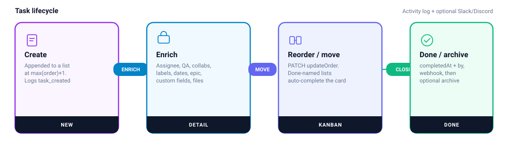

# Tasks

A task lives on a list. Members with board access can create, edit, move, comment, and attach files. Completing and archiving are first-class states.

## Create

`POST /api/tasks/createTask` `{ title, listId }`

1. List must exist and the caller must `hasBoardAccess` on its board.
2. `order = lastTask.order + 1` (or 0).
3. Activity `task_created`.

Bulk (AI brain dump, MCP): `POST /api/boards/[boardId]/batchTasks` creates many cards with optional description, priority, dates, quarter, epic, and nested subtasks, then logs `activity.brainDump`.

## Update

`PATCH /api/tasks/updateTask/[taskId]`

Writable fields: title, description, completed, startDate, dueDate, priority, epicId, quarter, archived, assigneeId, qaId, listId.

This handler does **not** re-check `memberCanAssign` when `assigneeId` / `qaId` are sent here. The dedicated assign/QA routes do.

**Done-list shortcut:** if the card is moved to a list whose title matches `isDoneList` (`done` / `hecho` / `completad` / `finaliz`) and `completed` was not sent, the API sets `completed`, `completedAt`, and `completedById`. Moving out of a done list reopens it.

Activity types from this handler: `task_moved`, `task_completed` / `task_reopened`, `task_renamed`. Completing also calls `sendBoardWebhookNotification({ eventType: "task_completed" })`.

## Reorder (Kanban)

`PATCH /api/tasks/updateOrder`

Body: `{ items: [{ id, order, listId }], movedTaskId, fromListId, toListId }`.

All tasks and lists must belong to **one** board (cross-board updates 400). On a list change it logs `task_moved`. This path does **not** auto-complete from the list title — that happens on `updateTask`.

## Delete

`DELETE /api/tasks/deleteTask/[taskId]` — access + activity.

## Enrichment APIs

| Concern | Route |
|---|---|
| Assignee | `POST /api/tasks/[taskId]/assignee` (and `assignees`) |
| QA | `POST /api/tasks/[taskId]/qa` |
| Collaborators | `/api/tasks/[taskId]/collaborators` |
| Labels | `/api/tasks/[taskId]/labels` |
| Subtasks | `/api/tasks/[taskId]/subtasks` |
| Comments | `/api/tasks/[taskId]/comments` |
| Custom field values | `/api/tasks/[taskId]/custom-values` |
| Attachments | `POST /api/tasks/[taskId]/attachments` → Vercel Blob `attachments/{taskId}/{name}` |
| Private link | `/board/{boardId}?taskId={taskId}` — always available; no access redirects to `/dashboard?access=denied` |
| Public share link | `/api/tasks/[taskId]/share` (session required; reading needs read access to the board, switching the link on or off needs edit access; anyone else gets 404) |

Priority values used in the UI: Urgent, High, Medium, Low.

Subtasks are a checklist (`completed` + `order`). The card shows `completed/total`.

Attachments are private blobs. Download goes through `/api/tasks/[taskId]/attachments/[attachmentId]/download`. The file type is the one its uploader chose, so only plain images, PDFs and text open in the tab; anything else (HTML, SVG, scripts) is served as a download, with `nosniff` and a sandboxing CSP, so an uploaded page cannot run on the app's origin (`lib/attachmentHeaders.ts`).

## Archive and epics

`archived` / `archivedAt` hide work from the active board. `/api/boards/[boardId]/archive` lists archived cards. Epics group tasks (`Epic.status` open/completed, optional `quarter` like `2026-Q1`). Tasks can also store their own `quarter`.

## Parent and child diagram

The **Parent ticket** and **Child ticket** custom fields define the task dependency graph (both fields support one or multiple tickets). Saving either field keeps the other side in sync.

Every origin of the linked tickets is a path origin (`ORIGEN`), including an archived ancestor. Origins that do not share a parent stay in the same path. Their direct children are step `01`, in the stored child list order. Parallel tasks on the same step appear side-by-side in a two-column layout, and a downstream ticket that is blocked by multiple parents is placed on the step after all of its blocking parents complete, including parents that belong to another origin. Archived tickets stay in the path and are drawn in muted type. A ticket with no parent and no children draws nothing. A cycle stops at the repeated ticket. Separate paths that never meet keep their own step counts.

## Dashboard and calendar reads

- Dashboard aggregates pending, overdue, completed-this-week, assigned-to-me.
- `/api/calendar` feeds the month view with due-dated tasks.
- Cmd+K hits `/api/search`.

### MCP task writes and history

MCP read/write credentials support task creation, epic creation, edits, moves, completion and
archiving within their organization/board scope. The creator must still have
board edit permission. Read-only credentials remain unchanged. OAuth write
access is approved explicitly during consent. Ticket writes store before/after
state in `McpChange` and board activity in the same serializable transaction;
completion sends the existing board webhooks after commit. Epic creation records
board activity only and cannot be reverted through MCP. Settings → MCP
provides administrator-only history preview and confirmed revert, independently
of whether the original credential remains active. Reverts reject later edits
and missing original lists, and undo ticket creation by archiving. Sent integration
messages are not recalled. See `mcp/README.md` for scope and supported fields.

### Expanded MCP ticket contract

MCP reads now include assignee/QA identities, collaborators, checklist,
comments, attachment metadata, sharing and all custom-field definitions and
values. Project metadata supplies accessible people and field options. Ticket
listing supports assignee name/email, assignee/QA IDs and cursor pagination.
Writable credentials can edit every user-editable ticket field, including QA,
custom values, labels, epic, quarter, collaborators, checklist, comments,
private attachments and sharing. Assignment honors `memberCanAssign`; comment
edits require authorship or admin permission. Parent/child synchronization is
journaled across all affected tickets; reverts check nested state for later
edits. System IDs/timestamps and calendar integration IDs remain read-only.
See `mcp/README.md` for request shapes, upload limits, retained blobs and client
tool refresh after deployment.
